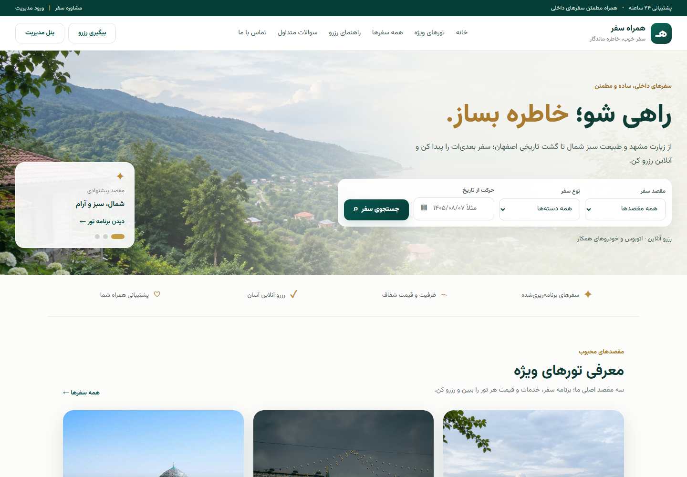
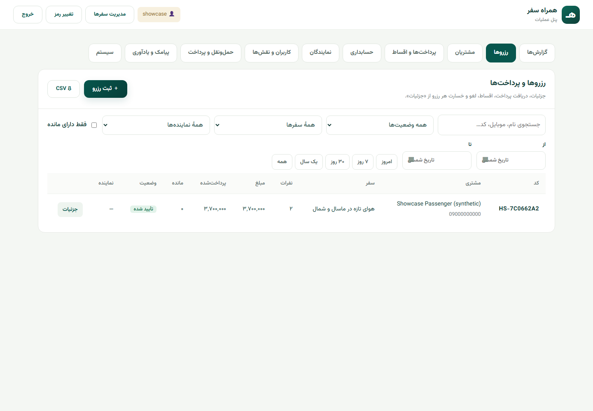

# HamrahSafar

A Persian, right-to-left application for **domestic travel booking and travel-agency operations**. Customers browse trips and track reservations; staff manage bookings, customer records, payments, installments and agency workflows.

**Status:** current project with ongoing deployment work. Local booking, office and internal sandbox-payment flows are verified below. The presence of a gateway adapter does not establish live payment activation or a completed production launch.



## My contribution

I'm **Ramtin Farzane**. My work on this project focuses on the **backend, database and VPS deployment**. The frontend is included here as application context; contribution claims are limited to those confirmed responsibilities.

Booking logic checks price, dates and remaining capacity on the server and creates the booking/payment plan inside a database transaction. Staff and agent permissions control access to office records. See the [booking service](server/office/finance.js) and [review and verification notes](docs/README.md#verification-and-review).

## What you can inspect

- Trip browsing, Jalali date presentation, reservations and tracking by reference plus phone.
- A trip administration screen at `/admin.html` and a separate operations workspace at `/office.html`.
- Customer records, scoped agent workflows, payment schedules, receipts, cancellation accounting, reports and reminder/SMS logs.
- An internal payment simulator and a Zarinpal request/verification adapter. Local testing used the simulator and logging SMS only; live provider behavior is unverified.



## Run and check

The package declares **Node >=20**; Netlify selects **Node 22**. This pass used **Node 24.11.1 / npm 11.6.2**. The app is JavaScript with Express 5 and libSQL/SQLite; no TypeScript checker or separate lint command is configured.

```bash
git clone https://github.com/boyInShadows/HamrahSafar.git
cd HamrahSafar
npm ci
```

Before `npm start`, configure an isolated `DATA_DIR` and local admin credentials in your process environment. Real credentials on the maintainer's Windows machine belong in Windows user environment variables. See the [local setup and deployment guide](docs/README.md) for configuration, startup and the synthetic walkthrough.

```bash
npm run check
npm test
npm run build
npm start
```

`npm run build` creates a static frontend in `dist/`. Login, database access, bookings, uploads, payments and reminders require the running Express backend. A static preview alone cannot provide those services.

Local verification: **21 tests passed**, JavaScript syntax checks and frontend build passed, and dependency audit reported zero findings on 29 October 2026. Chromium checks covered the storefront at 1440/360px, sandbox payment failure/retry, booking tracking and authenticated office display. [Exact commands and limits](docs/README.md#verification-and-review) distinguish those results from production verification.

## Persian overview

همراه‌سفر برای معرفی سفرهای داخلی، ثبت و پیگیری رزرو و مدیریت امور آژانس ساخته شده است. مسئولیت فعلی من توسعه بک‌اند، پایگاه داده و استقرار روی VPS است. راه‌اندازی و بررسی استقرار ادامه دارد؛ پرداخت در بررسی محلی با شبیه‌ساز داخلی انجام شده و عملکرد درگاه واقعی تأیید نشده است.

## Limits and further reading

[Public setup, deployment, payment behavior and verification](docs/README.md) cover persistent storage, backend/frontend configuration and known operational limits. The older trip-admin cancellation path does not calculate penalties; use the office workflow for cancellation accounting. Screenshots contain illustrative tour data and a synthetic passenger, not customer records. Existing ownership and asset credits remain applicable; no new license is assigned.
